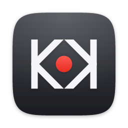

<picture>
  <source media="(prefers-color-scheme: light)" srcset="docs/brand/final-V1/icon/icon-light-256.png">
  
</picture>

# Skreenrek

A small, free, open-source macOS screen-capture tool for coding agents such as Claude Code, Codex and Cursor. It is one
binary with a menu-bar app, a CLI, an MCP server and an agent skill.

## Why

Skreenrek gives an agent what it needs to record a window and use the result:

- **Size.** It resizes the window to an exact pixel size and reads the frame back, so the agent can verify the size
  instead of assuming it.
- **Quality.** It records at native resolution and a constant 30 or 60 fps, in H.264 by default.
- **Output.** Each recording gets its own folder with `clip.mp4`, `events.json` and a HyperFrames snippet, so the agent
  has the video, the cursor and click data, and a paste-ready clip element.

## Install

Requires macOS 15 Sequoia or later.

```sh
brew tap r4ph-t/skreenrek https://github.com/R4ph-t/skreenrek
brew install --cask r4ph-t/skreenrek/skreenrek
open /Applications/Skreenrek.app
```

The cask installs Skreenrek.app into `/Applications` and links the `skreenrek` command. The app is unsandboxed, signed
with a Developer ID and notarized by Apple. The tap URL is needed because the tap lives in this repo.

### First run

The app walks you through its permissions the first time it opens:

- **Screen Recording** is required. macOS applies it only after a restart of the app, so click Quit & Reopen when
  Skreenrek offers it.
- **Direct Capture** is required. It is the macOS prompt about skipping the system's private window picker.
- **Accessibility** is what lets Skreenrek resize windows. You can skip it and still record a window at its current
  size.

Then connect your agents:

```sh
skreenrek setup agents
```

Setup detects `~/.claude`, `~/.codex` and `~/.cursor`, and installs the `record-window` skill and the `skreenrek` MCP
server for each one it finds. Use `--claude`, `--codex` or `--cursor` to choose clients yourself, and `--cli` to link
the command into `~/.local/bin`. Existing configs get a `.skreenrek-backup` before their first edit, and other servers
and settings stay in place.

## Quick start

Ask your agent to record something:

```text
Use the record-window skill to record my Safari window at 1080p and 60 fps while you
click through the sign-up flow on localhost:3000. Give me the paths to the clip, the
events file and the HyperFrames snippet.
```

Or use the CLI directly:

```sh
# List the windows you can record
skreenrek windows --app Safari

# Resize a window and read the size back
skreenrek resize --app Safari --size 1280x800

# Start recording; this returns immediately
skreenrek record --app Safari --size 1080p --fps 60

# Stop, write the files and print their paths
skreenrek stop

# Print the paths of the last clip as JSON
skreenrek last --json
```

`--size` takes `720p`, `1080p`, `1440p`, `4k`, `square`, `portrait`, or `WxH` in pixels. It sets the size of the clip:
Skreenrek fits the window to the display, captures it at native resolution and scales it down to that size. If the
size read back isn't exact, the command fails unless you pass `--allow-inexact`.

To record for a fixed time instead of calling `stop`, add `--duration 30s --wait`. Add `--json` for machine-readable
output. `skreenrek <command> --help` lists the rest of the flags.

<!-- screenshot: menu panel, added after next release -->

## Output files

Each recording gets a folder in `~/Movies/Skreenrek/`, named like `2026-11-17_104207_safari`. Use `--out` to put it
somewhere else.

| File | Contents |
| --- | --- |
| `clip.mp4` | The video: H.264 at a constant frame rate. `--codec` and `--format` select HEVC, ProRes or MOV, and a MOV is written as `clip.mov`. |
| `events.json` | Cursor samples, mouse downs and ups, and clicks, in video pixels and timed from the first frame. It also holds the recording's details and stats. It contains no keystrokes. `--no-events` skips it. |
| `hyperframes.html` | A `<video>` element to paste into a HyperFrames composition, with a comment showing how to copy the clip into `assets/`. `--assets DIR` copies the clip there for you. |

## Troubleshooting permissions

Run `skreenrek doctor` to see what is missing.

- **Screen Recording is allowed but Skreenrek still says it's off.** macOS applies this grant only to a new process.
  Click Quit & Reopen in the setup window, or quit Skreenrek from the menu bar and open it again.
- **A permission is missing.** Choose "Permissions needed…" in the Skreenrek menu.
- **macOS asks again after an upgrade.** Cask installs keep their grants across `brew upgrade --cask skreenrek`, with
  one exception: the first release after 1.0.5 changes Skreenrek's app ID, so macOS asks once more. Source builds need
  a [permission reset](CONTRIBUTING.md#reset-permissions-after-a-rebuild) after each rebuild.

## Uninstall

Remove the agent connections first, because the zap step deletes the record of what setup added:

```sh
skreenrek setup agents --remove
brew uninstall --zap --cask skreenrek
```

Your recordings stay in `~/Movies/Skreenrek/`.

## Contributing

Building from source and the release process are in [CONTRIBUTING.md](CONTRIBUTING.md). Release history is in
[CHANGELOG.md](CHANGELOG.md).

## License

[MIT](LICENSE)
